<div align="center">

# Open Univer

**Неофициальный клиент [univer.kaznu.kz](https://univer.kaznu.kz) для Android. Открытый код, бесплатно, никаких серверов.**

Расписание, оценки, журнал, сессия, УМКД, дистанционное обучение, e-услуги и калькулятор баллов КазНУ им. аль-Фараби собраны в одном удобном приложении.

[](https://github.com/Nursulltan/OpenUniver/releases/latest)
[](LICENSE)


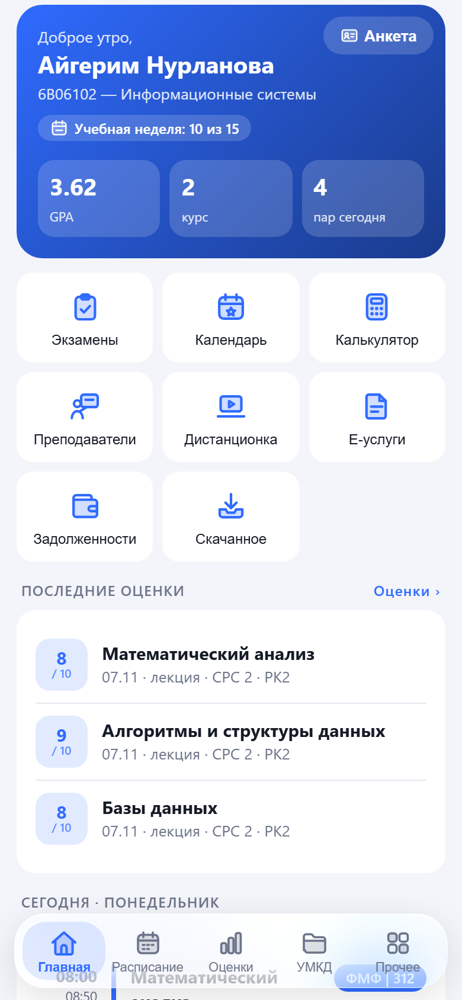 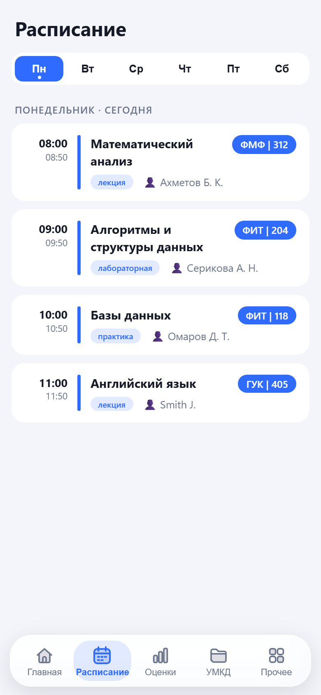 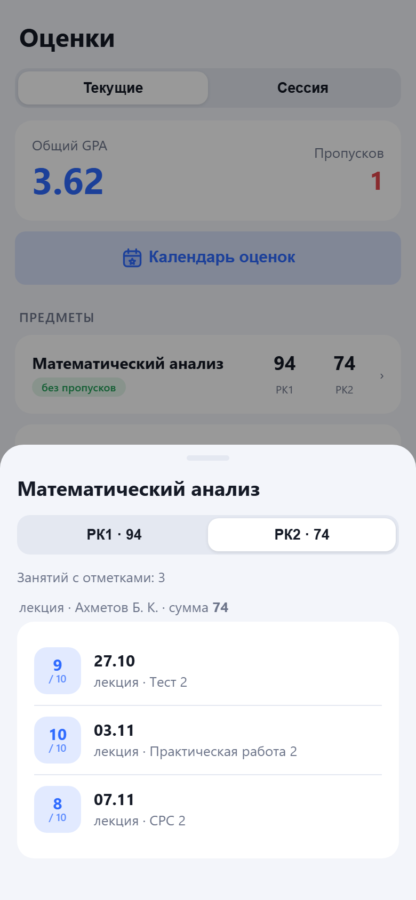 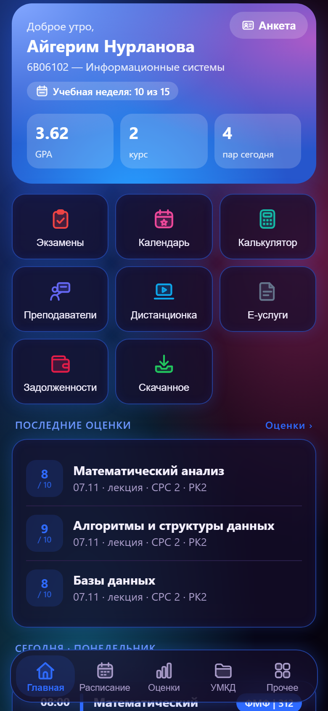

[**⬇ Скачать APK**](https://github.com/Nursulltan/OpenUniver/releases/latest) · [Возможности](#возможности) · [Как это работает](#как-это-работает) · [Какие данные откуда](#какие-данные-откуда-берутся) · [Сборка](#сборка) · [English](#english)

</div>

> [!IMPORTANT]
> **Open Univer — независимый студенческий проект.** Он не связан с КазНУ им. аль-Фараби, не одобрен им и не является официальным приложением университета. Все названия и данные принадлежат их владельцам.

---

## Зачем это сделано

Сайт univer.kaznu.kz создавался для компьютера. С телефона на нём неудобно смотреть оценки, расписание и материалы: страницы долго грузятся, мелкие таблицы приходится увеличивать, а сессия часто сбрасывается.

Open Univer — это попытка сделать нормальный мобильный интерфейс для того же самого личного кабинета:

- **быстро:** данные кэшируются, приложение открывается сразу и обновляется в фоне;
- **удобно:** всё важное помещается на одном экране, есть уведомления о новых оценках;
- **честно:** код открыт, у приложения нет своих серверов, вашим паролем никто, кроме университета, не пользуется.

Приложение сделано студентами для студентов. Оно бесплатное, без рекламы, без аналитики и без трекеров.

## Возможности

| | |
|---|---|
| 🏠 **Главная** | Приветствие, GPA, курс, учебная неделя, пары на сегодня, последние оценки. Плитки можно переставлять долгим нажатием, а лишние блоки скрыть. |
| 📅 **Расписание** | Занятия по дням недели: время, тип (лекция / практика / лабораторная), преподаватель, корпус и аудитория. Отдельно есть расписание экзаменов. |
| 📊 **Оценки** | Текущие баллы РК1/РК2 по каждому предмету, журнал: сколько баллов из максимума, за какое задание и в какой день, пропуски, календарь оценок. |
| 🎓 **Сессия** | Зачётка по годам и семестрам: итоговые баллы, буквенные оценки, кредиты, GPA. |
| 🧮 **Калькулятор** | Сколько баллов нужно набрать на экзамене, чтобы закрыть предмет, получить стипендию или повышенную. |
| 📁 **УМКД** | Учебные материалы по дисциплинам: силлабусы, лекции, практики. Файлы скачиваются и открываются прямо в приложении. |
| 💻 **Дистанционка** | Курсы дистанционного обучения, недели и задания. |
| 👩‍🏫 **Преподаватели** | Эдвайзер и преподаватели по каждому предмету. |
| 📝 **E-услуги** | Справки и заявления из сервисного центра (открываются во встроенном окне сайта). |
| 💳 **Задолженности** | Академические задолженности и информация об оплате. |
| 🪪 **Анкета** | Карточка студента и учётные записи (Wi-Fi, Office 365). |
| 🔔 **Уведомления** | Приложение само проверяет журнал и сообщает о новой оценке. |
| 🔒 **Защита** | PIN-код (4 или 6 цифр), пароль, графический ключ, отпечаток пальца или лицо. |
| 🎨 **Дизайн** | 11 готовых стилей, светлая и тёмная тема, любой акцентный цвет, фото на фон, форма карточек, меню и иконок. |
| 🌐 **Языки** | Қазақша, русский, English. |

## Скриншоты

> Скриншоты сделаны на **выдуманных демо-данных**: имя, предметы и оценки не настоящие.

<table>
<tr>
<td align="center"><br><sub>Главная</sub></td>
<td align="center"><br><sub>Расписание</sub></td>
<td align="center">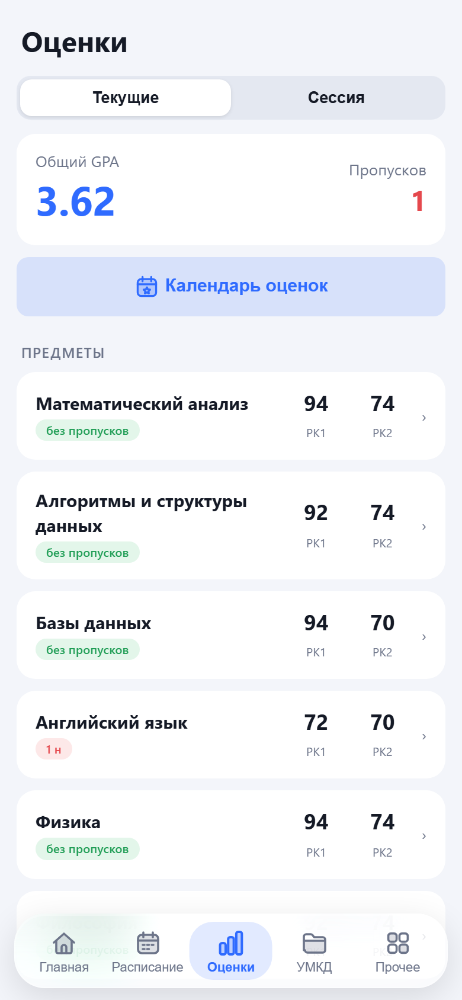<br><sub>Оценки</sub></td>
</tr>
<tr>
<td align="center">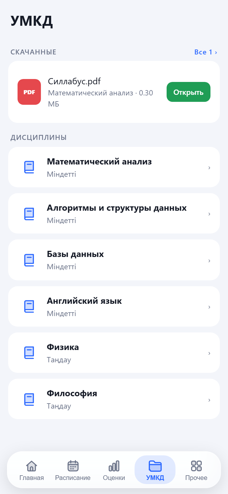<br><sub>УМКД и скачанные файлы</sub></td>
<td align="center"><br><sub>Журнал: баллы из максимума</sub></td>
<td align="center">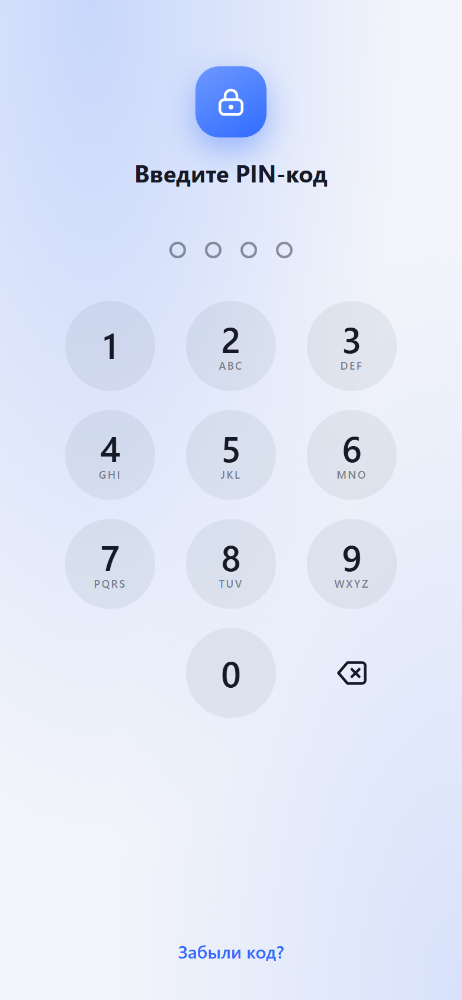<br><sub>Блокировка PIN-кодом</sub></td>
</tr>
</table>

### Дизайн под себя

<table>
<tr>
<td align="center">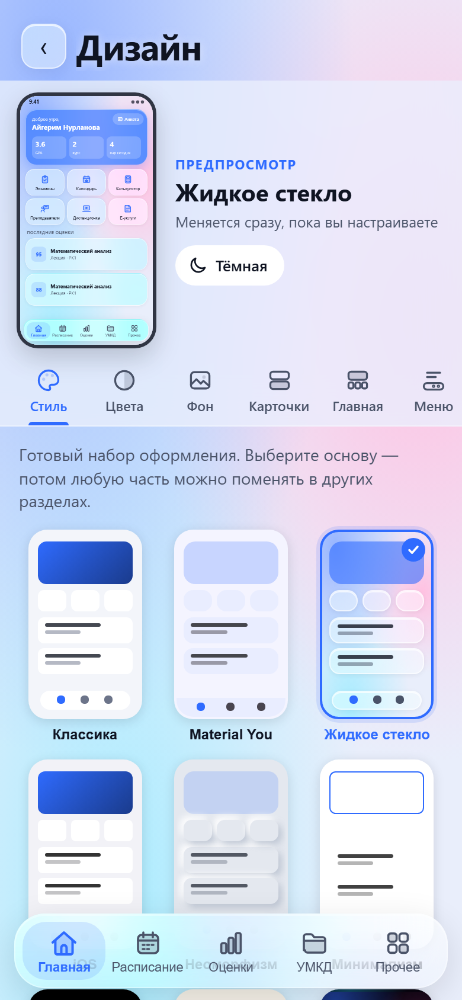<br><sub>Редактор дизайна</sub></td>
<td align="center">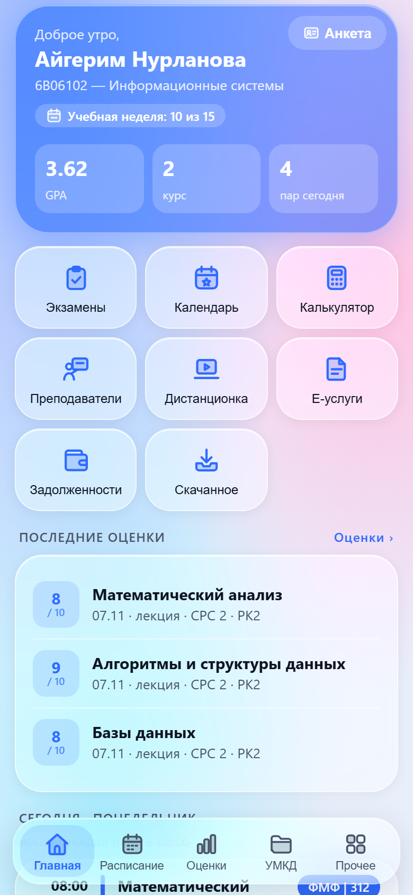<br><sub>Жидкое стекло</sub></td>
<td align="center"><br><sub>Neon (тёмная)</sub></td>
<td align="center">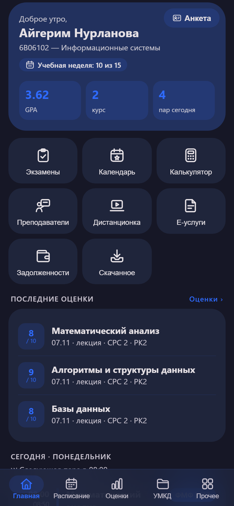<br><sub>Material You (тёмная)</sub></td>
<td align="center">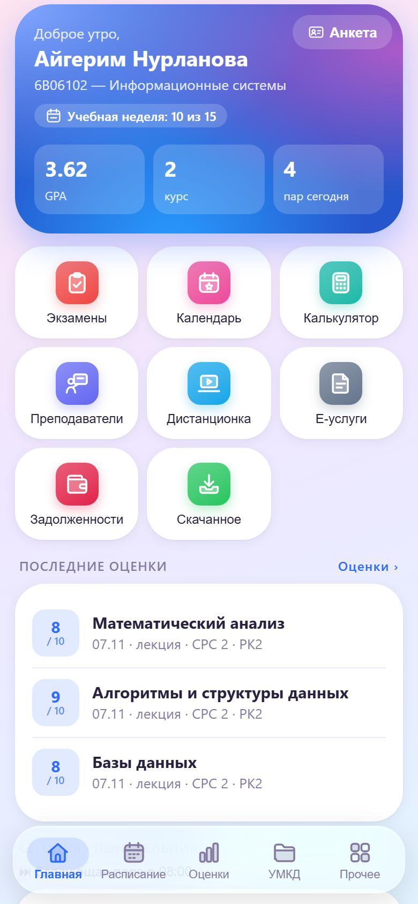<br><sub>Candy</sub></td>
</tr>
</table>

Готовые стили: Классика, Material You, Жидкое стекло, iOS, Неоморфизм, Минимализм, AMOLED, Бумага, Neon, Брутализм, Candy. В каждом можно отдельно поменять цвета, фон (в том числе своё фото с размытием и затемнением), карточки, главный экран, нижнее меню, иконки и размер текста. Изменения сразу видны в живом превью.

## Установка

1. Откройте [последний релиз](https://github.com/Nursulltan/OpenUniver/releases/latest) и скачайте файл `Open-Univer-*.apk`.
2. Откройте его на телефоне. Android попросит разрешить установку из этого источника, разрешите.
3. Войдите с **тем же логином и паролем, что и на univer.kaznu.kz**.

> [!NOTE]
> APK подписан debug-ключом, поэтому Google Play Protect может показать предупреждение. Если сомневаетесь, [соберите приложение сами](#сборка) из исходников, это несложно.

---

## Как это работает

Главная идея: **приложение — это и есть «сервер»**. Весь код, который ходит на сайт университета и разбирает ответы, работает прямо на телефоне. Никаких посредников между вами и КазНУ нет.

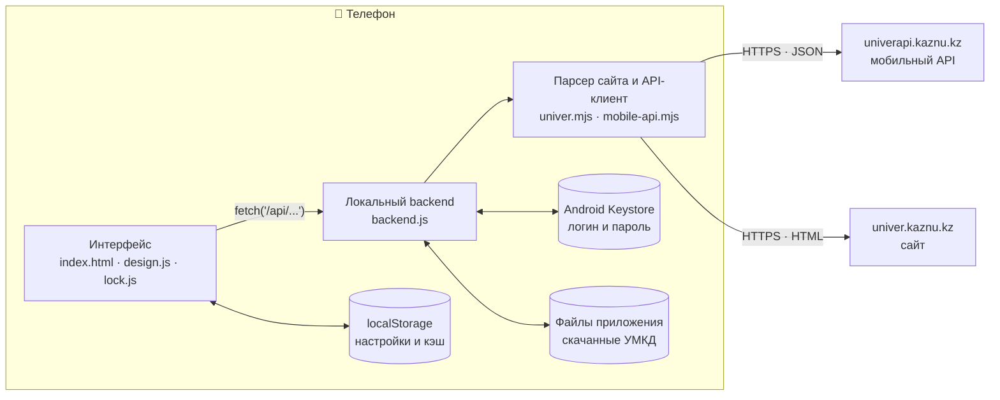

### Слои

1. **Интерфейс** ([`kaznu-test/index.html`](kaznu-test/index.html)) — одностраничное приложение на чистом JavaScript без фреймворков. Обращается к данным через `fetch('/api/...')`, как к обычному серверу.
2. **Локальный backend** ([`kaznu-app/src/backend.js`](kaznu-app/src/backend.js)) перехватывает эти запросы внутри WebView. Маршруты `/api/profile`, `/api/grades`, `/api/schedule` и другие вызывают нужный метод парсера. Здесь же работа с Keystore, файлами и уведомлениями.
3. **Парсер** ([`kaznu-test/univer.mjs`](kaznu-test/univer.mjs)) входит на сайт, ходит по страницам личного кабинета и разбирает HTML через [cheerio](https://cheerio.js.org/). [`mobile-api.mjs`](kaznu-test/mobile-api.mjs) — отдельный клиент мобильного API университета.
4. **Нативная часть** (Capacitor + свои Java-плагины): HTTP-запросы без ограничений CORS, хранилище Keystore, биометрия, уведомления, окно e-услуг, запрет скриншотов при включённой блокировке.

Тот же код парсера запускается и на компьютере ([`kaznu-test/server.mjs`](kaznu-test/server.mjs)) — так удобно разрабатывать интерфейс в браузере.

### Вход и сессия

- При входе логин и пароль отправляются **только** на `univer.kaznu.kz` и `univerapi.kaznu.kz`, как при обычном входе на сайт.
- После успешного входа они сохраняются в **Android Keystore** (через [`@aparajita/capacitor-secure-storage`](https://github.com/aparajita/capacitor-secure-storage)) и больше нигде.
- Сайт периодически сбрасывает сессию. Тогда приложение тихо входит заново с сохранёнными данными и повторяет запрос. Если пароль сменили, оно попросит войти снова.
- «Выйти» удаляет логин, пароль, cookies и отметки просмотренных оценок.

### Кэш и офлайн

Ответы сохраняются в `localStorage`. При открытии экрана сначала показывается сохранённая копия, затем в фоне приходят свежие данные (stale-while-revalidate). Поэтому приложение открывается мгновенно и работает без интернета, показывая последнюю загруженную версию.

Ответы мобильного API дополнительно кэшируются в памяти: профиль, расписание и семестр на 5 минут, остальное на 1 минуту.

### Уведомления о новых оценках

Пока включены уведомления, приложение держит лёгкий фоновый сервис (KeepAlive) и раз в 1–2 минуты (в случайный момент, чтобы не создавать равномерной нагрузки) загружает журнал. Новые отметки сравниваются с уже показанными, и для каждой новой приходит локальное уведомление. Всё это происходит на телефоне, push-серверов нет.

## Какие данные откуда берутся

У университета есть два источника: **мобильный API** (`univerapi.kaznu.kz`, JSON) и **сайт** (`univer.kaznu.kz`, HTML). Приложение использует API там, где он отдаёт полные и правильные данные, а в остальных местах разбирает страницы сайта.

### Через мобильный API (JSON)

Если API не ответил или вернул ошибку, приложение автоматически берёт те же данные со страницы сайта (`_preferApi` → HTML-запасной путь).

| Данные | Метод API | Запасной путь на сайте |
|---|---|---|
| Профиль: ФИО, курс, специальность | `student/profile/` | `/student/profile/` |
| Расписание занятий | `student/schedule/` (по дням 1–6, параллельно) | `/student/myschedule/` |
| Расписание экзаменов | `student/examSchedule/` | `/student/myexam/schedule/` |
| Список дисциплин УМКД | `student/umkd2/` + `student/semesterInfo/` | `/student/umkd/` |
| Файлы дисциплины УМКД | `student/umkdFull/` | `/student/umkd/{id}/{год}/{семестр}` |

### Со страниц сайта (HTML)

| Данные | Страница |
|---|---|
| Текущие оценки, РК1/РК2, общий GPA | `/student/attestation/` |
| Журнал: даты, баллы, названия заданий, пропуски | `/student/attendance/full/` |
| Максимальные баллы за задания | `/student/interactive/syllabus/bind/ajax/{группа}/` |
| Карточка студента | `/student/profile/` |
| Учебная неделя | `/student/academcalendar/` |
| Сессия (зачётка) и учебный план | `/student/recbook/`, `/student/educplan/` |
| Преподаватели и эдвайзер | `/student/advicer/` |
| Дистанционное обучение | `/student/discussion/...` |
| Учётные записи (Wi-Fi, Office 365) | `/student/bachelor/` |
| E-услуги | `/ssc/`, `/ssc/UserServiceList`, `/ssc/StatementList` |
| Задолженности и оплата | `/student/fail/`, `/student/failfx/`, `/student/payinfo/` |
| Анкетирование преподавателей | `/student/rating/` |
| Скачивание файлов УМКД | `/student/umkd/get/...` |

### Почему не всё через API

Мы сравнили ответы API и сайта на реальном аккаунте. Для части разделов API пока не подходит:

- в журнале через API (`attendanceFullNew`) нет названий заданий и максимальных баллов;
- аттестация через API в проверке отдавала РК2 = 0 и GPA = 0, хотя на сайте значения были;
- у занятий из запроса расписания с `day=0` нет дня недели.

Поэтому оценки, GPA, журнал и максимумы берутся с сайта: там данные совпадают с тем, что видит студент в браузере.

## Безопасность и приватность

- **Нет своих серверов.** Запросы идут только на `univer.kaznu.kz` и `univerapi.kaznu.kz`. Нет аналитики, рекламы, трекеров, логов на чужих серверах.
- **Пароль в Keystore.** Логин и пароль хранятся в зашифрованном хранилище Android, а не в обычных настройках.
- **Код блокировки** не хранится в открытом виде, только PBKDF2-SHA-256-отпечаток (120 000 итераций, случайная соль). После нескольких неверных попыток ввод временно блокируется. «Забыли код?» выполняет выход из аккаунта.
- **Биометрию** проверяет сама система Android (`androidx.biometric`), приложение не видит отпечатков и лица.
- При включённой блокировке экран приложения **не попадает в скриншоты** и список недавних приложений (`FLAG_SECURE`).
- **Скачанные файлы** лежат во внутренней памяти приложения (или в «Документах», если вы так выбрали в настройках).
- Удалите приложение, и все его данные исчезнут с телефона.

Нашли уязвимость? Пожалуйста, не публикуйте её в открытом issue, а напишите автору через [GitHub](https://github.com/Nursulltan).

## Ответственность

> [!WARNING]
> **Правильность данных никто не гарантирует.** Ни автор, ни участники проекта не обещают, что оценки, баллы, GPA, расписание, сроки и задолженности в приложении правильные, полные и актуальные, и не несут за это ответственности. Данные могут отличаться из-за изменений или ошибок на сайте университета, ошибок в приложении или устаревшей сохранённой копии. Расчёты калькулятора — только примерная оценка.
>
> **Всегда проверяйте важное на официальном сайте или в деканате.** Приложение предоставляется «как есть», без каких-либо гарантий ([лицензия](LICENSE)), вы используете его на свой страх и риск. Полный текст пользовательского соглашения есть в самом приложении: «Прочее → Пользовательское соглашение».

---

## Структура репозитория

```
OpenUniver/
├── kaznu-test/              # интерфейс + парсер (общий код)
│   ├── index.html           # всё приложение: экраны, стили, логика
│   ├── i18n.js              # переводы kz / ru / en
│   ├── design.js            # система дизайна: стили, цвета, фото-фон
│   ├── lock.js              # экран блокировки: PIN, пароль, ключ, биометрия
│   ├── univer.mjs           # вход на сайт и разбор HTML
│   ├── mobile-api.mjs       # клиент мобильного API + кэш
│   ├── server.mjs           # dev-сервер для запуска в браузере
│   ├── design.html          # галерея всех стилей
│   └── *.test.mjs           # тесты
├── kaznu-app/               # Android-приложение (Capacitor)
│   ├── src/backend.js       # локальный backend: /api/*, Keystore, файлы, уведомления
│   ├── build-web.mjs        # сборка www/ через esbuild
│   ├── build-apk.sh         # полная сборка APK
│   └── android/             # Android-проект + свои Java-плагины
│       └── app/src/main/java/io/github/univerclient/
│           ├── BiometricPlugin.java     # отпечаток / лицо, FLAG_SECURE
│           ├── KeepAlivePlugin.java     # фоновая проверка оценок
│           ├── ServicePortalPlugin.java # окно e-услуг
│           └── TactilePlugin.java       # вибрация
└── docs/screenshots/        # скриншоты для README (демо-данные)
```

## Сборка

### Запуск в браузере (для разработки интерфейса)

Нужен Node.js 22+.

```bash
cd kaznu-test
npm install
npm start
```

Откройте `http://127.0.0.1:3000` и войдите своим логином Univer. Dev-сервер слушает только `127.0.0.1` и хранит пароль только в памяти, а cookies сессии в `kaznu-test/.session.json` (файл в `.gitignore`).

Тесты:

```bash
cd kaznu-test && npm test
```

### Сборка APK

Нужны Node.js 22+, JDK 21 и Android SDK (platform 36).

```bash
cd kaznu-app
npm install
node build-web.mjs
npx cap sync android
cd android && ./gradlew assembleDebug
```

Готовый файл: `kaznu-app/android/app/build/outputs/apk/debug/app-debug.apk`.

Если JDK и SDK лежат не в стандартных местах, поправьте пути в [`kaznu-app/build-apk.sh`](kaznu-app/build-apk.sh) и запускайте его: он делает все шаги сразу.

## Как помочь

- Нашли ошибку или неправильные данные — откройте [issue](https://github.com/Nursulltan/OpenUniver/issues) с описанием и скриншотом. **Замажьте личные данные** (ФИО, ИИН, оценки, логин).
- Хотите что-то улучшить — делайте fork и pull request.
- Сайт университета иногда меняет вёрстку, из-за этого может сломаться разбор какой-то страницы. Такие исправления особенно полезны.

Никогда не прикладывайте к issue свой пароль, cookies или файл `.session.json`.

## Лицензия

**[PolyForm Noncommercial 1.0.0](LICENSE)** · © 2026 [Nursultan](https://github.com/Nursulltan). Автор проекта — Nursultan, авторские права сохраняются за ним.

| ✅ Можно (бесплатно) | ❌ Нельзя |
|---|---|
| Пользоваться приложением | Продавать приложение или его код |
| Читать и изучать код | Брать деньги за установку, доступ или функции |
| Собирать приложение самому | Встраивать рекламу, платные подписки и т. п. |
| Изменять код и делать свои версии | Использовать код в коммерческом продукте или для заработка |
| Делиться копиями и своими версиями бесплатно | Убирать указание автора и текст лицензии |

Каждая копия или изменённая версия должна сохранять файл `LICENSE` со строкой `Required Notice` (указание автора).

Нужно использование в коммерческих целях? Это возможно только с отдельного письменного разрешения автора — напишите через [GitHub](https://github.com/Nursulltan).

---

## English

**Open Univer** is an unofficial, open-source Android client for [univer.kaznu.kz](https://univer.kaznu.kz), the student portal of Al-Farabi Kazakh National University. It is an independent student project and is **not affiliated with or endorsed by KazNU**.

- **Features:** schedule, current grades and gradebook, exam session results, score calculator, UMKD course materials with downloads, distance learning, teachers, e-services, debts, new-grade notifications, app lock (PIN / password / pattern / biometrics), 11 visual styles with a full theme editor, Kazakh / Russian / English UI.
- **No servers.** The app talks only to `univer.kaznu.kz` (HTML pages, parsed on the device with cheerio) and `univerapi.kaznu.kz` (the university's mobile JSON API). The API is used for profile, schedule, exams and UMKD, with an automatic HTML fallback. Grades, GPA, the gradebook and max points come from the website because the API returns incomplete data there.
- **Privacy:** credentials are stored only in the Android Keystore; there is no analytics, ads or tracking. The lock code is stored as a PBKDF2-SHA-256 hash.
- **No warranty:** nobody guarantees the data shown is correct, complete or up to date. Always verify important information on the official website. Provided "as is".
- **License:** [PolyForm Noncommercial 1.0.0](LICENSE), © 2026 Nursultan. You may use, study, modify and share the code for free, for any **noncommercial** purpose, keeping the author notice. Selling it, charging for it, adding ads or paid features, or using it in any commercial product is not allowed without the author's written permission.

[Download the latest APK](https://github.com/Nursulltan/OpenUniver/releases/latest).
